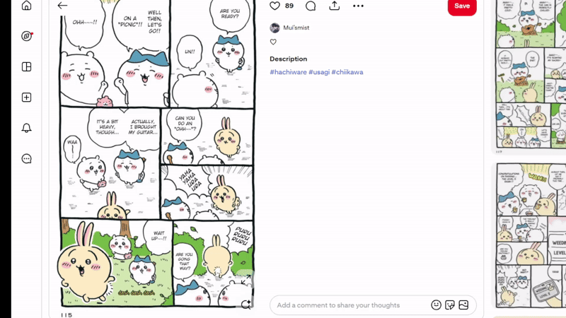
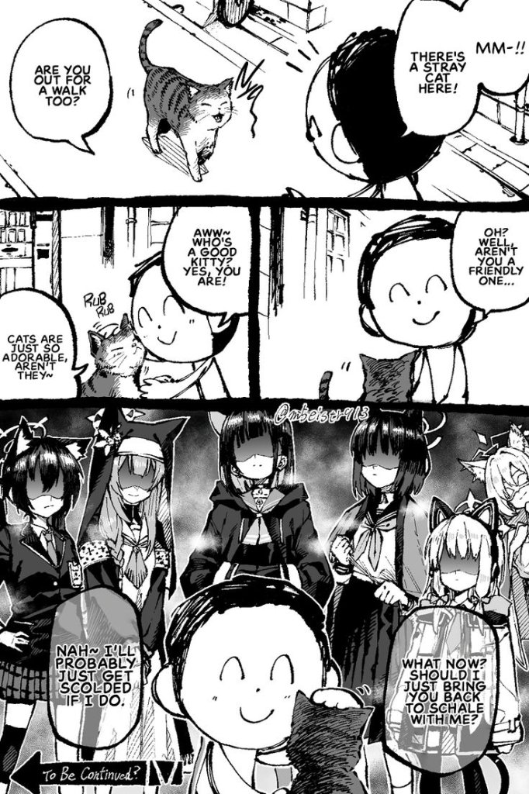
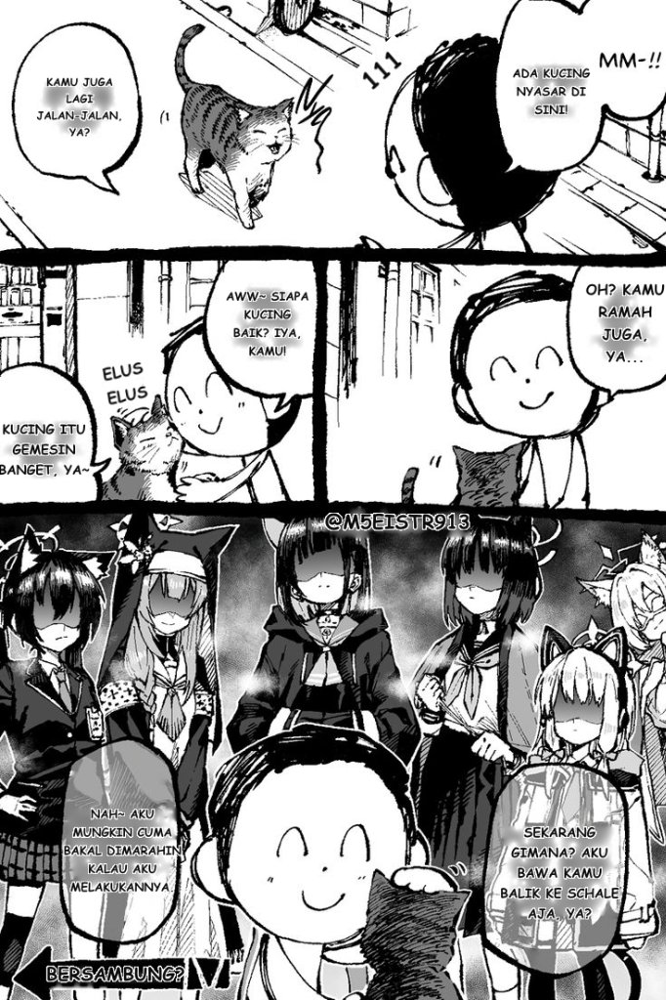

# MyTranslation-rs

[](https://github.com/SirAshesh/MyTranslation-rs/releases)
[](https://github.com/SirAshesh/MyTranslation-rs/commits/main)


[](https://id.pinterest.com/pin/1005569423056533419/)

A fast, lightweight, and native Rust translation and typesetting server for manga, manhwa, and comics. It features built-in RapidOCR (DirectML on Windows, high-performance ONNX Runtime on Linux), stroke-level bubble cleaning that preserves screentones, automatic typesetting with `comic_bold.ttf`, and translation powered by cloud APIs (DeepSeek, OpenAI, Claude) or fully local on-device models (Tencent HY-MT1.5 1.8B and LiquidAI LFM3 1.7B via llama.cpp with CUDA, Vulkan, or CPU acceleration).

## Key Features
- **Cross-Platform**: Runs natively on both **Windows 10/11 (x64)** and **Linux / Ubuntu (x64)**.
- **Single Standalone Binary**: No Python environment, PyTorch, or heavy runtime dependencies required.
- **Multilingual Support**: Supports horizontal comics (LTR) and vertical Japanese manga (tategaki, RTL) with automatic line joining and junk/SFX filtering.
- **Flexible Translation Backends**:
  - **Local Model**: 1-click built-in download and execution of Tencent HY-MT1.5 1.8B or LiquidAI LFM3 1.7B with automatic hardware detection (NVIDIA CUDA, AMD/Intel Vulkan, or CPU).
  - **Cloud APIs**: OpenAI-compatible (DeepSeek, OpenAI, OpenRouter) and Claude-compatible endpoints.
- **Browser Extension Ready**: Includes standalone **MyTranslation** extensions for Chrome (`chrome-extension.zip`) and Firefox (`firefox-extension.zip`).

## Sample

| RAW | Translated |
| :--- | :--- |
|  |  |

Source: https://id.pinterest.com/pin/614600680437863284/

## Quick Start

1. **[Installation](docs/Installation.md)** - Install and start `MyTranslation-rs` on Windows (x64), Linux/Ubuntu (x64), or build from source.
2. **[Connect Local Client](docs/Connect-Local-Client.md)** - Configure the local model/API dashboard

## Configuration

Settings are saved in `config.json` in the application directory:

```json
{
  "port": 5000,
  "translation_mode": "local",
  "openai_base_url": "https://api.deepseek.com",
  "openai_model": "deepseek-chat",
  "deepseek_api_key": "sk-your-key-here",
  "claude_base_url": "https://api.anthropic.com",
  "claude_model": "claude-3-5-sonnet-latest",
  "claude_api_key": "",
  "local_model": "HY-MT1.5-1.8B-Q4_K_M"
}
```

- **Web Dashboard**: Navigate to `http://127.0.0.1:5000` to adjust settings, check detected GPU/RAM hardware, and download local models directly from the UI.
- **Port**: Customize the listening port by modifying `"port"` in `config.json` or passing `PORT=5000 ./server-rs`.

## Credit
- xulihang / [ImageTrans Chrome Extension](https://github.com/xulihang/ImageTrans_chrome_extension)
- koharu-rs / [Koharu](https://github.com/koharu-rs/koharu)

## License
MIT License.
